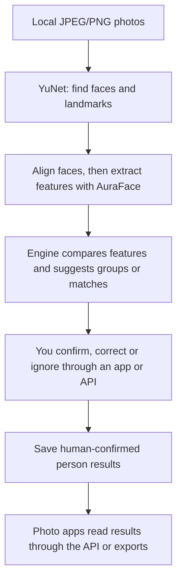

# Person Engine

[English](README.md) | [中文](README.zh-CN.md)

**Experimental Developer Preview — Public V0** · package version **0.1.0**

**A local engine for organizing people in photos: suggest which faces belong to the same person, let a human confirm, and make the results available to photo apps.**

Suppose you have a collection of family photos and want to find the ones with Mom.
With models configured, Person Engine detects faces and suggests groups or matches
that may refer to the same person. You confirm, correct or ignore those suggestions
through an integrating app or the developer API. The engine saves the confirmed
results so the app can show photos by person.

## Who is it for today?

**Developers** adding people-related features to photo apps and organizing tools.
This repository provides a Python library, a local API and exportable results.
Developers can call it directly or integrate it into an application. The application
needs to provide the photo browser, review screens and search interface; there is
no ready-made, one-click photo-app plugin.

**This is an experimental developer preview.** Real-photo use requires configuring
external models. Real-model recognition quality, calibration and real-photo
production use have not been validated. The quickstart below uses synthetic data
to verify service workflows only.

## How does it work?

The engine proposes; a human confirms before results become saved person identities.



Face grouping (technically, *face clustering*) puts faces that may belong to the
same person together; it does not tell you that person's name. The engine can also
suggest identity matches against existing person records. A machine suggestion
does not automatically become a confirmed identity.

### Which models does it use?

| Component | Role |
|---|---|
| **YuNet** | Finds face locations and landmarks in a photo. |
| **AuraFace** | Turns an aligned face into numerical features for the engine to compare. |
| **Person Engine** | Organizes match/group suggestions and human decisions, saves results and makes them available to other apps. |

The integrated real-model route is **YuNet + AuraFace**. Users supply their own
model files; this repository includes no weights and does not download them
automatically. AuraFace weight provenance and redistribution permission remain
unverified; see the [external model policy](models/README.md).

### What could you build with it?

These are possible application directions for developers, **not bundled products
or existing integrations**:

- **Personal or family photo apps**: browse photos by human-confirmed person.
- **Desktop photo organizers**: assist with person labels and review/correct face groups.
- **Local photo-selection tools for photographers**: filter photos by confirmed person.
- **Home NAS photo apps**: add people-related organization, with runtime adaptation and authentication/access controls provided by the application. The current engine service is for localhost, single-user use only.

## Capabilities and boundaries

- Register local JPEG/PNG assets and run explicitly configured inference.
- Review non-authoritative matching/grouping candidates and apply human decisions.
- Read person facts through the `/v1` API and publish versioned JSON snapshots.
- Export immutable snapshots for independent consumers without giving them write authority.

There is no HTTP photo upload, automatic model download, multi-user authentication
or production-ready recognition claim. Synthetic acceptance verifies the service
chain with artificial inputs; it is not a face-recognition model.

## Privacy and local-first data

Data stays in operator-selected local workspaces. Imports read originals and copy
bytes into engine-owned storage without modifying the originals. Face embeddings,
identity facts and exported snapshots can be sensitive; local-first does not mean
anonymous. Protect workspaces, exports and backups. Never upload real photos,
workspace databases, registry files, embeddings, real-identity snapshots or secrets
to public issues. Snapshots can include names and identity metadata even though
they omit pixels and embedding vectors. Deleting the source checkout does not
delete external runtime data. These documents are not a legal compliance guarantee.
Read the [privacy notice](docs/privacy.md) before using personal data.

## Quickstart: synthetic Docker acceptance

**TEST / ACCEPTANCE ONLY.** This path uses generated uniform pixels and artificial
vectors, not a recognition model. No model weights or real photos are needed.
Requirements: Docker with Compose V2 and BuildKit, Python 3.12, and a non-root
local user. Dependency installation/build requires network access. Run these
commands from a fresh copy of this repository. Keep this shell open so the
variables remain available.

```sh
# quickstart-start
export PERSON_ENGINE_DEMO_ROOT="$(mktemp -d)"
cp .env.example .env
mkdir -p "$PERSON_ENGINE_DEMO_ROOT/workspace" "$PERSON_ENGINE_DEMO_ROOT/photos" "$PERSON_ENGINE_DEMO_ROOT/models"
export PERSON_ENGINE_WORKSPACE_PATH="$PERSON_ENGINE_DEMO_ROOT/workspace"
export PERSON_ENGINE_PHOTO_PATH="$PERSON_ENGINE_DEMO_ROOT/photos"
export PERSON_ENGINE_MODEL_PATH="$PERSON_ENGINE_DEMO_ROOT/models"
export PERSON_ENGINE_UID="$(id -u)" PERSON_ENGINE_GID="$(id -g)"
export PERSON_ENGINE_PROVIDER=synthetic_acceptance
# Choose another free host port if 8000 is already in use.
export PERSON_ENGINE_PORT=8000
docker compose build
docker compose up -d --wait
curl --fail "http://127.0.0.1:$PERSON_ENGINE_PORT/health"
curl --fail --output /dev/null "http://127.0.0.1:$PERSON_ENGINE_PORT/docs"
# quickstart-end
```

Open `http://127.0.0.1:8000/docs` to explore the API (adjust the browser URL if you selected another host port). Swagger UI loads its assets
from an external CDN; `/health`, `/openapi.json` and the JSON API do not need that
CDN. Health confirms process liveness, not recognition readiness. The shell
exports above explicitly override `.env.example`'s real-provider default.

Verify the complete register → ingest → review → apply → snapshot → restart chain
with the independent HTTP consumer. It runs in a separate Python environment
without the service package. The runner creates its own anonymous fixtures,
disposable workspaces and loopback port, tests the real-provider empty-model
behavior, then explicitly selects synthetic acceptance. It does not use the
quickstart workspace or any personal `.env` directories.

```sh
# acceptance-start
export PERSON_ENGINE_CLIENT_ENV="$PERSON_ENGINE_DEMO_ROOT/client-env"
python3.12 -m venv "$PERSON_ENGINE_CLIENT_ENV"
"$PERSON_ENGINE_CLIENT_ENV/bin/python" -m pip install httpx==0.28.1 jsonschema==4.26.0
python3.12 -B scripts/docker_acceptance.py \
  --client-python "$PERSON_ENGINE_CLIENT_ENV/bin/python" \
  --output "$PERSON_ENGINE_DEMO_ROOT/acceptance"
# acceptance-end
```

A successful run prints `Docker synthetic acceptance PASS`; consumer assertions
and HTTP evidence are under the chosen output directory. It exercises all 20
endpoints, JPEG/PNG imports, replay/conflict handling, human decisions, snapshots,
container recreation, persistence and loss of old in-memory job IDs. It removes
its own containers and networks. Stop the separate quickstart service with
`docker compose down`. Keep or delete the disposable demo directory yourself;
removing containers or the source checkout does not delete external workspace data.

## Current limits

- Real-model calibration and recognition quality are **not validated**;
  `PUBLIC_CALIBRATION_GAP` remains open.
- AuraFace is **EXTERNAL_ONLY / USER_SUPPLIED / REDISTRIBUTION_NOT_VERIFIED**.
  A model-card license claim is not verification of a supplied weight's provenance.
- JPEG/PNG decode is portable. Linux HEIC is unsupported; Public V0 imports accept
  JPEG/PNG only.
- Linux arm64 is the verified Docker runtime; linux/amd64 is **METADATA_ONLY**,
  not runtime-verified.
- No authentication: single-user, localhost-only service. Do not expose it to a
  public interface. One process owns a dedicated workspace.
- Jobs are in memory and are not restart-durable. Core facts, receipts and
  snapshots persist; old job IDs return `JOB_NOT_FOUND` after restart.

## Native setup and real-model inputs

Use CPython 3.12 in a dedicated environment:

```sh
python3.12 -m venv .venv
. .venv/bin/activate
python -m pip install -r requirements-api-lock.txt
python -m pip install --no-build-isolation --no-deps -e .
python -m person_engine.api --root ../person-engine-workspaces
```

Without explicit model configuration this starts with model-unavailable
diagnostics. See [local API](docs/local-api.md), [Docker/import guide](docs/docker-runtime.md),
[library usage](docs/usage.md) and [external model policy](models/README.md).
There is no automatic model download or synthetic fallback. Real inference uses
user-supplied YuNet and AuraFace files, expected hashes and explicit detector and
matching parameters; no calibrated production defaults are supplied. The generic
SFace adapter is not an integrated Public V0 inference fallback. AuraFace remains
**EXTERNAL_ONLY / USER_SUPPLIED / REDISTRIBUTION_NOT_VERIFIED**. Its model-card
Apache-2.0 claim does not resolve a supplied weight file's provenance or authorize
its redistribution. This does not block publication of the project source.

## Workspace, imports and snapshots

Docker uses three distinct operator-selected directories:

| Host setting | Container directory | Access |
| --- | --- | --- |
| `PERSON_ENGINE_WORKSPACE_PATH` | `/data/person-engine` | Read/write state, imports and runtime files |
| `PERSON_ENGINE_PHOTO_PATH` | `/media/photos` | Read-only originals |
| `PERSON_ENGINE_MODEL_PATH` | `/models` | Read-only user-supplied model files |

Use fresh dedicated workspaces and keep synthetic and real-model data separate.
The Docker API service root is `/data/person-engine/service`. Create a workspace
with `POST /v1/workspaces`, retain its returned `workspace_id`, and use the exact
returned `source_directory`; do not reconstruct directory names from IDs.

```sh
# Set SOURCE_DIRECTORY to the exact source_directory returned by the API.
docker compose exec -T person-engine python -m person_engine.import_tool \
  --root /data/person-engine/service \
  --source-directory "$SOURCE_DIRECTORY" \
  --source-root /media/photos --source album/example.jpg
```

This explicit helper copies approved local JPEG/PNG bytes without modifying
originals. It does not register an asset or perform inference. Register the
receipt's imports-relative `source_path`, digest, byte count and media type through
`POST /v1/workspaces/{workspace_id}/assets`, with the required logical source,
revision and idempotency fields. Never send a host absolute photo path to the API.
See the [complete import flow](docs/docker-runtime.md#explicit-import-then-unchanged-http-api).

Continue through ingest jobs, review, decisions and apply; then publish and export
an immutable versioned JSON snapshot. Exported snapshots omit pixels, paths and
embedding vectors but retain human-confirmed facts and identity metadata. They
can be read without the engine database. Publishing a snapshot creates durable
engine state; export is a separate operation, not automatic public sharing.

## Contracts and validation

- [HTTP contract](docs/public-v0-api-contract.md), [OpenAPI](docs/openapi.json),
  [error codes](docs/public-v0-error-codes.md) and [snapshot contract](docs/snapshot-contract.md)
- [Synthetic provider](docs/synthetic-acceptance.md), [decode boundary](docs/linux-decode-compatibility.md),
  [calibration](docs/calibration.md), [limitations](docs/public-v0-limitations.md) and [architecture](docs/architecture.md)

From the native environment above, anonymous tests run in disposable workspaces:

```sh
python -B scripts/run_release_tests.py --report /tmp/person-engine-core-tests.json
python -B scripts/run_api_tests.py --live --report /tmp/person-engine-api-tests.json
python -B scripts/test_image_decode.py --report /tmp/person-engine-decode-tests.json
```

## License and security

Copyright 2026 VectorLetter. Project source is licensed under [Apache-2.0](LICENSE).
Dependencies retain their own licenses; no model weights are distributed or
relicensed by this project. Read [third-party notices](THIRD_PARTY_NOTICES.md),
[licensing boundaries](docs/licensing.md) and [security reporting](SECURITY.md).
