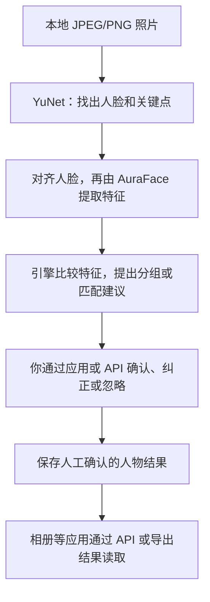

# Person Engine

[English](README.md) | [中文](README.zh-CN.md)

**Experimental Developer Preview — Public V0**（实验性开发者预览版）· 包版本 **0.1.0**

**一个在本地运行的照片人物整理引擎：辅助把同一个人的脸分到一起，由你确认身份，再把结果交给相册等应用使用。**

比如，你有一批家人的照片，希望整理出“哪些照片里有妈妈”。Person Engine 可以在配置好模型后，
找出人脸、提出“这些脸可能是同一个人”的分组或匹配建议。你通过接入它的应用或开发接口
确认、纠正或忽略这些建议后，引擎保存确认结果，供应用按人物展示照片。

## 现在适合谁用？

目前适合想给相册、照片整理工具添加人物功能的**开发者**，还不是普通用户安装后就能直接使用的相册软件。
仓库提供 Python 库、本地 API 和可导出的结果；开发者可以单独调用，也可以接入自己的应用。
照片浏览、人物审核和搜索等操作界面需要由应用提供，当前没有现成的一键相册插件。

**这是实验性开发者预览版。** 使用真实照片前，需要自行配置模型；真实模型的识别效果、
参数校准和真实照片生产使用仍未完成验证。下面的快速开始使用合成数据，仅验证服务流程。

## 它是怎么工作的？

机器先提出建议，人工确认后才保存为人物身份结果。



“人脸分组”（技术上叫“人脸聚类”）是把可能属于同一个人的脸放在一起；它本身不知道这个人叫什么。
与已有的人物记录比较时，引擎也可以提出身份匹配建议，但不会把机器的猜测自动当成已确认身份。

### 用到什么模型？

| 组件 | 做什么 |
|---|---|
| **YuNet** | 找到照片中的人脸位置和关键点。 |
| **AuraFace** | 把对齐后的人脸转换成一组特征数字，供引擎比较相似程度。 |
| **Person Engine** | 组织匹配、分组建议和人工决定，保存结果并提供给其他应用。 |

当前接入的真实模型流程是 **YuNet + AuraFace**。模型文件需由使用者自行提供，仓库不附带权重，也不会自动下载。
AuraFace 权重的来源及再分发许可仍未核实；详见[外部模型政策](models/README.md)。

### 可以接到哪些应用？

以下是开发者可以构建的应用方向，**不是已经提供的成品或现成集成**：

- **个人／家庭相册**：按人工确认的人物浏览照片。
- **桌面照片整理工具**：辅助人物标注，复核和纠正分组结果。
- **摄影师的本地选片工具**：按已确认的人物筛选相关照片。
- **家庭 NAS 相册**：接入人物整理能力；需要适配运行环境，并由应用处理身份认证和访问安全。当前引擎服务仅面向 localhost 单用户使用。

## 主要能力与职责边界

- 注册本地 JPEG/PNG 资源，并运行显式配置的推理流程。
- 审核不具有最终身份决定权的匹配、分组候选，并应用人工决定。
- 通过 `/v1` API 读取人物事实，发布版本化 JSON 快照。
- 导出不可变快照供独立消费者读取，不赋予消费者写入引擎事实的权限。

本项目不提供 HTTP 照片上传、自动模型下载或多用户身份认证，也不宣称具备生产级识别能力。
合成验收模式用人工构造的输入验证服务链路；它不是人脸识别模型。

## 隐私与本地数据边界

数据保存在操作者选择的本地工作区（workspace）中。导入流程只读原照片，
将字节复制到引擎管理的存储，不修改原照片。人脸特征向量（embeddings）、
身份事实和导出快照可能包含敏感数据；本地优先不等于匿名化。
请保护工作区、导出文件和备份。不要向公开 issue 上传真实照片、工作区数据库、
registry 文件、embeddings、包含真实身份的快照或 secrets。
快照虽然不包含像素和特征向量，仍可能包含姓名及身份元数据。
删除源码目录不会删除外部运行数据。这些文档不构成法律合规保证。
使用个人数据前，请阅读[隐私说明](docs/privacy.md)。

## 快速开始：Docker 合成验收

**TEST / ACCEPTANCE ONLY（仅用于测试／验收）。** 此流程使用生成的均匀像素和人工向量，
不使用识别模型，也不需要模型权重或真实照片。
前提：支持 Compose V2 和 BuildKit 的 Docker、Python 3.12，以及非 root 的本地用户。
安装依赖和构建镜像需要网络。请在本仓库的全新副本中执行以下命令，
并保持同一个 shell 会话，以便后续继续使用这些变量。

```sh
# quickstart-start
export PERSON_ENGINE_DEMO_ROOT="$(mktemp -d)"
cp .env.example .env
mkdir -p "$PERSON_ENGINE_DEMO_ROOT/workspace" "$PERSON_ENGINE_DEMO_ROOT/photos" "$PERSON_ENGINE_DEMO_ROOT/models"
export PERSON_ENGINE_WORKSPACE_PATH="$PERSON_ENGINE_DEMO_ROOT/workspace"
export PERSON_ENGINE_PHOTO_PATH="$PERSON_ENGINE_DEMO_ROOT/photos"
export PERSON_ENGINE_MODEL_PATH="$PERSON_ENGINE_DEMO_ROOT/models"
export PERSON_ENGINE_UID="$(id -u)" PERSON_ENGINE_GID="$(id -g)"
export PERSON_ENGINE_PROVIDER=synthetic_acceptance
# Choose another free host port if 8000 is already in use.
export PERSON_ENGINE_PORT=8000
docker compose build
docker compose up -d --wait
curl --fail "http://127.0.0.1:$PERSON_ENGINE_PORT/health"
curl --fail --output /dev/null "http://127.0.0.1:$PERSON_ENGINE_PORT/docs"
# quickstart-end
```

打开 `http://127.0.0.1:8000/docs` 查看 API。Swagger UI 从外部 CDN 加载页面资源；
`/health`、`/openapi.json` 和 JSON API 不依赖该 CDN。
健康检查只表示进程存活，不表示识别能力就绪。
上面的环境变量显式覆盖 `.env.example` 默认的真实模型提供方配置。
若 8000 端口已被占用，请选择其他空闲主机端口，并相应调整浏览器地址。

使用独立 HTTP 消费者验证完整的注册 → 摄取 → 审核 → 应用 → 快照 → 重启链路。
消费者运行在未安装服务包的独立 Python 环境中。验收脚本创建自己的匿名样例、
一次性工作区和回环端口，先检查真实模型模式在模型目录为空时的行为，
再显式启用合成验收模式。它不使用上面快速开始的工作区，也不使用个人 `.env` 中的数据目录。

```sh
# acceptance-start
export PERSON_ENGINE_CLIENT_ENV="$PERSON_ENGINE_DEMO_ROOT/client-env"
python3.12 -m venv "$PERSON_ENGINE_CLIENT_ENV"
"$PERSON_ENGINE_CLIENT_ENV/bin/python" -m pip install httpx==0.28.1 jsonschema==4.26.0
python3.12 -B scripts/docker_acceptance.py \
  --client-python "$PERSON_ENGINE_CLIENT_ENV/bin/python" \
  --output "$PERSON_ENGINE_DEMO_ROOT/acceptance"
# acceptance-end
```

成功时会输出 `Docker synthetic acceptance PASS`；消费者断言和 HTTP 证据保存在所选输出目录。
验收覆盖全部 20 个端点、JPEG/PNG 导入、重放与冲突处理、人工决定、快照、
容器重建、持久化，以及重启后旧内存任务 ID 的失效。验收脚本会移除自己创建的容器和网络。
另行启动的快速开始服务可用 `docker compose down` 停止。
一次性演示目录由你自行保留或删除；移除容器或源码目录不会删除外部工作区数据。

## 当前限制

- 真实模型校准和识别质量**尚未验证**；`PUBLIC_CALIBRATION_GAP` 仍未关闭。
- AuraFace 状态为 **EXTERNAL_ONLY / USER_SUPPLIED / REDISTRIBUTION_NOT_VERIFIED**。
  模型卡上的许可声明不等于已核实用户提供权重的来源。
- JPEG/PNG 解码可跨平台运行。Linux 不支持 HEIC；Public V0 只接受 JPEG/PNG 导入。
- Linux arm64 是已验证的 Docker 运行环境；linux/amd64 仍为 **METADATA_ONLY**，尚未完成运行验证。
- 没有身份认证：服务面向单用户，仅限 localhost。不要暴露到公网接口。
  一个进程独占一个专用工作区。
- 任务保存在内存中，不能跨重启持久保存。核心事实、回执和快照会持久化；
  重启后查询旧任务 ID 返回 `JOB_NOT_FOUND`。

## 原生安装与真实模型输入

使用 CPython 3.12 和独立虚拟环境：

```sh
python3.12 -m venv .venv
. .venv/bin/activate
python -m pip install -r requirements-api-lock.txt
python -m pip install --no-build-isolation --no-deps -e .
python -m person_engine.api --root ../person-engine-workspaces
```

未显式配置模型时，服务会启动并报告模型不可用。
参见[本地 API](docs/local-api.md)、[Docker／导入指南](docs/docker-runtime.md)、
[库用法](docs/usage.md)和[外部模型政策](models/README.md)。
服务不会自动下载模型，也不会自动回退到合成模式。
真实推理使用用户提供的 YuNet 和 AuraFace 文件、预期哈希值，以及显式检测和匹配参数；
项目不提供经过校准的生产默认值。通用 SFace 适配器不是 Public V0 集成推理流程的回退方案。
AuraFace 仍为 **EXTERNAL_ONLY / USER_SUPPLIED / REDISTRIBUTION_NOT_VERIFIED**。
模型卡的 Apache-2.0 声明不能解决某个权重文件的来源问题，也不构成对其再分发的授权。
这不阻塞项目源码发布。

## 工作区、导入与快照

Docker 使用三个由操作者分别选择的目录：

| 主机配置项 | 容器目录 | 访问方式 |
| --- | --- | --- |
| `PERSON_ENGINE_WORKSPACE_PATH` | `/data/person-engine` | 可读写的状态、导入内容和运行文件 |
| `PERSON_ENGINE_PHOTO_PATH` | `/media/photos` | 只读原照片 |
| `PERSON_ENGINE_MODEL_PATH` | `/models` | 只读的用户自备模型文件 |

请使用全新的专用工作区，并将合成数据与真实模型数据分开。
Docker API 服务根目录为 `/data/person-engine/service`。
通过 `POST /v1/workspaces` 创建工作区，保留返回的 `workspace_id`，
并原样使用返回的 `source_directory`；不要根据 ID 自行推算目录名。

```sh
# Set SOURCE_DIRECTORY to the exact source_directory returned by the API.
docker compose exec -T person-engine python -m person_engine.import_tool \
  --root /data/person-engine/service \
  --source-directory "$SOURCE_DIRECTORY" \
  --source-root /media/photos --source album/example.jpg
```

此显式导入工具复制获准的本地 JPEG/PNG 字节，不修改原照片。
它不会注册资源或执行推理。随后通过 `POST /v1/workspaces/{workspace_id}/assets`，
提交回执中相对于导入目录的 `source_path`、摘要、字节数和媒体类型，
以及必需的逻辑来源、版本和幂等字段。不要把主机照片的绝对路径发送给 API。
参见[完整导入流程](docs/docker-runtime.md#explicit-import-then-unchanged-http-api)。

继续执行摄取任务、审核、保存决定和应用；然后发布并导出不可变的版本化 JSON 快照。
导出快照不含像素、路径和特征向量，但会保留人工确认的事实及身份元数据，
可在不访问引擎数据库的情况下读取。发布快照是在引擎内部建立持久状态；
导出是另一个操作，并不意味着自动公开分享。

## 契约与验证

- [HTTP 契约](docs/public-v0-api-contract.md)、[OpenAPI](docs/openapi.json)、
  [错误码](docs/public-v0-error-codes.md)和[快照契约](docs/snapshot-contract.md)
- [合成提供方](docs/synthetic-acceptance.md)、[解码边界](docs/linux-decode-compatibility.md)、
  [校准](docs/calibration.md)、[限制](docs/public-v0-limitations.md)和[架构](docs/architecture.md)

在上面的原生环境中运行以下命令，匿名测试会使用一次性工作区：

```sh
python -B scripts/run_release_tests.py --report /tmp/person-engine-core-tests.json
python -B scripts/run_api_tests.py --live --report /tmp/person-engine-api-tests.json
python -B scripts/test_image_decode.py --report /tmp/person-engine-decode-tests.json
```

## 许可与安全

Copyright 2026 VectorLetter。项目源码使用 [Apache-2.0](LICENSE) 许可。
依赖保留各自的许可证；本项目不分发模型权重，也不重新授权这些权重。
请阅读[第三方声明](THIRD_PARTY_NOTICES.md)、[许可边界](docs/licensing.md)
和[安全报告政策](SECURITY.md)。
